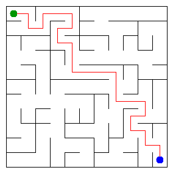

# Assignment 3. Maze Escape

Student ID: 205788  
Name: Abdukadirov Assylzhan  
Group: SE-2512  
Maze size (rows x columns): 11 x 11

This project implements the assignment algorithms in Java 17 or newer. The code uses only the Java standard library; there are no graph or DSU libraries.

## Personal files

The files in `data` were generated for student ID 205788. To regenerate them from this project folder:

```bash
java tools/MakeVariant.java 205788 data
javac -d out src/*.java
java -cp out Main
```

The generator replaces the two files in `data`. After regeneration, rerun `Main` and `java tools/Check.java`.

## Program output

These numbers are from the personal files for ID 205788.

```text
Broken: 120
Kept: 100
Last broken wall: 200
MST cost: 33456
Heaviest broken wall: 854
Path length: 26
DFS visited: 60
Dead ends: 35
Zones: 10
Largest zone: 19
Is DAG: 0
Flow stages: 7
Fastest route cost: 5
```

## My maze

The image below was generated from the personal files for ID 205788.



Open `output/maze.html` in a browser to walk through the maze. Use the arrow keys or W/A/S/D. The checkboxes show cell numbers, wall costs, the DFS path, strongly connected zones, and slides.

## Questions

### Mission 0. What do `find` and `union` do, and what makes them fast?

`find` returns the root of the set containing a cell. It uses two loops: one finds the root, and the other points every cell on the path directly to it. `union` joins different sets and attaches the smaller one to the larger one.

### Mission 1. Why is `Broken` always R*C - 1, and `Kept` always (R-1)*(C-1)?

A maze has `R*C` cells, and a connected tree needs exactly one fewer edge than vertices, so `Broken` is `R*C - 1`. The total number of inner walls is `R*(C-1) + C*(R-1)`; subtracting the broken walls gives `(R-1)*(C-1)` walls that stay.

### Mission 2. My MST cost from Kruskal and Prim, and why are they equal

For my maze, both algorithms give an MST cost of **33456**. Kruskal sorts all walls by cost, while my version of Prim keeps the cheapest known wall for each cell and updates it as the tree grows. Both algorithms find a minimum spanning tree, so their total cost is equal.

### Mission 3. Why is there exactly one path between two cells? How did you avoid a stack overflow on a huge maze?

Mission 1 breaks a wall only when it connects two different components. The result is connected and has no cycles, so there is exactly one path between any two cells. The DFS uses an explicit array stack instead of recursive method calls, so a large maze does not overflow the Java call stack.

### Mission 4. Why does the second pass of Kosaraju go on the reversed graph? Why do the slides have no cycle exactly when Zones equals the number of cells?

The first DFS records cells in finishing order. The second DFS follows reversed slides in decreasing finishing order, which separates the strongly connected components correctly. If there is no directed cycle, every component has one cell; if any component has more than one cell, those cells belong to a cycle, so `Zones` is smaller than the number of cells.

### Mission 5. Why is the zone order enough, and what does this pass cost?

Kosaraju numbers the zones in topological order, so every edge between different zones goes from a smaller zone number to a larger one. Processing zones in that order lets the program update the longest chain and cheapest route without a priority queue. The pass takes `O(n + s)` time, where `n` is the number of cells and `s` is the number of slides.

## AI use

I used ChatGPT to understand the algorithms, help implement the iterative DSU and the version of Prim that tracks each cell's cheapest wall, and check the program on the three provided examples. Before submitting, I will review the code and make sure I can explain every method.

## Timing (Mission 7)

These are five-run average timings measured with Java 25 in the current execution environment. Runtime depends on the computer and Java environment.

| Maze | Kruskal average (ms) | Prim average (ms) |
|---|---:|---:|
| 100 x 100 | 31 | 16 |
| 300 x 300 | 140 | 81 |
| 1000 x 1000 | 2143 | 1739 |

Both algorithms take longer as the maze grows because there are many more cells and walls to process. In these runs, Prim was faster on the largest input because it kept only the best known wall for each cell; exact times vary with hardware and JVM behavior.

## Complexity

Here, `n` is the number of cells, `m` is the number of walls, and `s` is the number of slides. `α(n)` is the inverse Ackermann function, which grows extremely slowly.

| Algorithm | Time | Space | Assumptions |
|---|---|---|---|
| DSU `find` / `union` | `O(α(n))` amortized per operation | `O(n)` | Path compression and union by size |
| Kruskal | `O(m log m)` | `O(n + m)` | Sorting the walls dominates; the graph is connected |
| Prim | `O(m log m)` | `O(n + m)` | Best cost per cell and a priority queue; the graph is connected |
| DFS escape | `O(n + m)` | `O(n + m)` | Iterative DFS; graph is built from the broken walls |
| Kosaraju | `O(n + s)` | `O(n + s)` | Two iterative DFS passes on the slide graph and its reverse |
| Route in the zone graph | `O(n + s)` | `O(n + s)` | Zones are already in topological order |

## Before you submit

- [x] Generate the personal files using student ID 205788.
- [x] Run `javac -d out src/*.java` and `java -cp out Main`.
- [x] Put the personal output, maze image, MST cost, and timing values in this report.
- [x] Run `java tools/Check.java`; all three examples pass.
- [x] Fill in the group.
- [ ] Make sure the AI-use note covers all earlier work.
- [ ] Review and understand the code; keep the AI-use note accurate.
- [ ] Make the required mission-by-mission Git commits, push to a public GitHub repository, and submit the repository link in Moodle.
